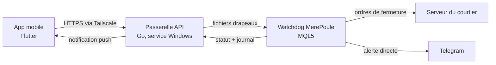
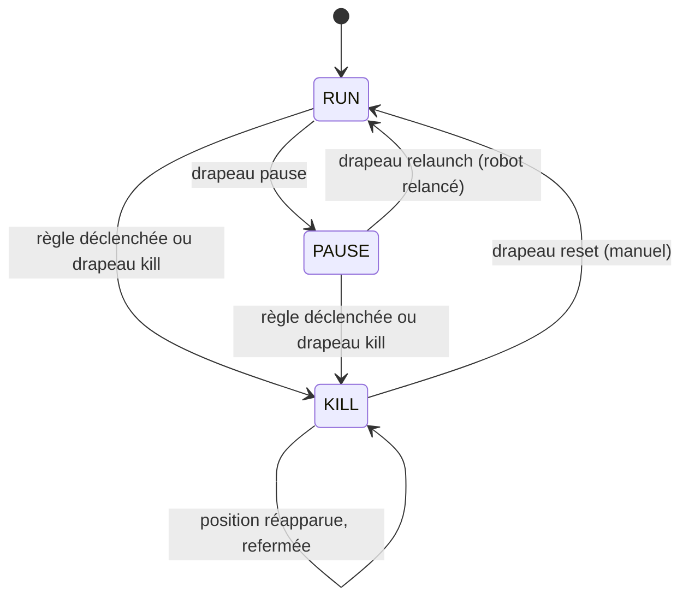
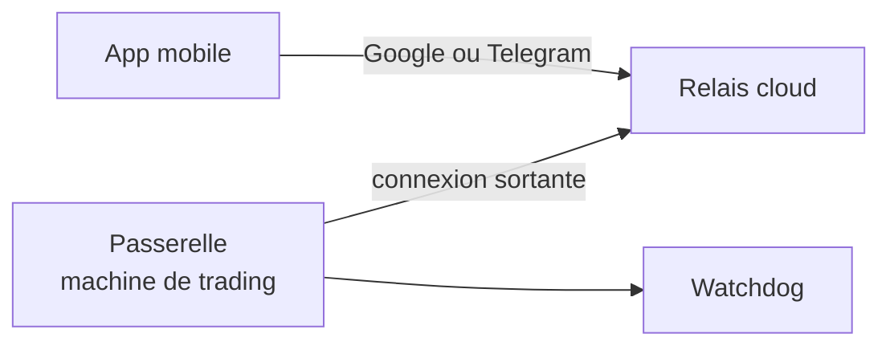

# MerePoule — Architecture technique

Sep 24, 2026 · @Richmond Gnanhi

## Vue d'ensemble

MerePoule compte trois composants : le Watchdog sur MT5, une passerelle API sur le VPS et une app mobile. **Seul le Watchdog décide d'un arrêt.** La passerelle et l'app sont une télécommande et une fenêtre : si elles tombent, la protection automatique continue.



Les deux composants du VPS ne se parlent que par fichiers : aucun port ouvert dans MT5, aucune dépendance réseau dans le chemin d'arrêt.

**Principes de conception**

- **Décision locale** : les règles de risque tournent dans le Watchdog, au plus près du compte.
- **Déterminisme** : règles fixes, aucune IA dans le chemin d'arrêt.
- **Fail-safe** : en cas de doute, on arrête ; la relance est toujours manuelle.
- **Idempotence** : un arrêt demandé deux fois produit le même état, jamais une réactivation.
- **Zéro écran** : ni capture, ni OCR, ni souris ; tout passe par les fonctions natives de MT5.
- **Deux canaux d'alerte indépendants** : Telegram envoyé par le Watchdog, push envoyé par la passerelle.

**Choix de langages** : MQL5 pour le Watchdog (seul langage exécuté dans MT5), Go pour la passerelle (binaire unique, service Windows sans runtime), Flutter pour l'app (iOS et Android avec un seul code).

## Machine de trading : VPS ou PC

MerePoule tourne sur n'importe quel Windows allumé 24 h/24 : un VPS ou un PC à la maison. Dans ce document, « VPS » désigne cette machine de trading, quelle qu'elle soit. L'architecture est la même ; le niveau de risque ne l'est pas.

| Panne | VPS | PC à la maison | Parade |
| --- | --- | --- | --- |
| Coupure d'électricité | Rare | Fréquente (délestages) | Onduleur pour le PC et la box ; BIOS réglé sur « redémarrer au retour du courant » |
| Coupure Internet | Rare | Fréquente | Box ou clé 4G de secours avec bascule automatique |
| Mise en veille | Non | Si non réglée | Mode d'alimentation sans veille ni veille prolongée |
| Redémarrage Windows Update | Planifiable | Surprise | Heures d'activité réglées, redémarrages planifiés à la main |
| Session fermée après redémarrage | À régler | À régler | Connexion automatique ; MT5 et passerelle lancés au démarrage |
| Adresse réseau changeante, connexions entrantes bloquées | Non | Oui | Tailscale (mode personnel) ou relais cloud (mode produit) |

**Conséquences pour MerePoule**

- Le Bouclier en mode catastrophe est **actif par défaut** : c'est la seule protection quand la machine tombe.
- La passerelle exécute un **diagnostic « Prêt pour le 24 h »** à son démarrage puis toutes les heures : veille, Windows Update, lancement au démarrage, connexion automatique. Résultat en langage simple dans l'app et sur Telegram : ce qui se passe, « Que faire » en clics, la commande pour les initiés à part.
- Au redémarrage, le Watchdog envoie l'alerte **« Machine redémarrée »** : durée d'arrêt, état, positions ouvertes.

Le VPS reste recommandé pour l'argent réel. Un PC domestique est acceptable avec onduleur, Internet de secours et Bouclier actif. MerePoule ne peut rien pendant une coupure : seuls les stop loss côté courtier protègent alors le compte.

## Composant 1 — Watchdog MerePoule (MQL5)

Le Watchdog est un Expert Advisor posé sur un graphique séparé de PETIT POUSSIN. Il lit le compte chaque seconde, applique les règles et exécute l'arrêt lui-même. Il ne modifie jamais le code du robot surveillé.

**États**



- **RUN** : robot en marche, règles et Bouclier actifs.
- **PAUSE** : robot coupé, positions gardées, toujours sous les règles et le Bouclier.
- **KILL** : compte à plat. RESET réarme en RUN sans relancer le robot ; RELANCER le relance ensuite.

L'état est stocké dans une variable globale du terminal, par numéro de compte : un redémarrage de MT5 ou du VPS ne réarme jamais le trading.

**Boucle (toutes les secondes)**

1. Mettre à jour le solde d'ouverture si le jour serveur a changé.
2. Écrire le statut.
3. Traiter un drapeau reset s'il existe.
4. Traiter une demande de configuration s'il en existe une.
5. En état KILL : refermer toute position réapparue, puis s'arrêter là.
6. Traiter un drapeau kill s'il existe.
7. Traiter un drapeau pause, puis relaunch, puis un réglage du robot.
8. Évaluer les règles de risque.
9. Bouclier : poser les stop loss catastrophe des nouvelles positions, et les recaler sur le prix chaque minute.
10. Interroger le calendrier économique (au plus une fois par minute).

**Règles de risque**

| Règle | Mesure | Seuil par défaut (v1.10) | Condition |
| --- | --- | --- | --- |
| Marge critique | Niveau de marge du compte | < 500 %, **alerte seule** | Seulement si au moins une position est ouverte ; passage en KILL après calibrage sur démo |
| Perte flottante | Equity − solde | ≤ −440 (devise du compte) | Toujours |
| Drawdown journalier | (Solde d'ouverture − equity) / solde d'ouverture | ≥ 5 % | Inclut les pertes déjà clôturées du jour |
| Recul depuis le plus haut | (Plus haut d'equity − equity) / plus haut | ≥ 20 %, à calibrer | Protège les gains latents ; plus haut remis à zéro chaque jour et à chaque réarmement |
| Annonce majeure | Calendrier MT5, importance haute | **Désactivée** (aucune devise) | Inutile sur les indices synthétiques 24/7 ; à réactiver pour le Forex |

Tous les seuils sont des paramètres d'entrée ; 0 désactive une règle. Un filtre par numéro magique limite la surveillance aux positions du robot.

Depuis la v1.20, les seuils de marge, de perte flottante, de drawdown et de recul se modifient aussi à distance, dans des plafonds réglables seulement dans MT5 (voir « Demande de configuration »). Aucune règle ne se désactive à distance.

**Bouclier suiveur (mode catastrophe)**

Le Bouclier pose un stop loss côté courtier sur les positions qui n'en ont pas. Quand la machine de trading tombe (courant, Internet, plantage), les règles du Watchdog ne tournent plus ; le stop loss du courtier, si. Actif par défaut (`InpShield`).

- **Budget** : perte supplémentaire acceptée si la machine tombe et que tous les stop loss sont touchés. Par défaut 2 fois le seuil de perte flottante actif (880 pour 440) ; `InpShieldBudget` le fixe en devise du compte.
- **Répartition** : les positions sont groupées par symbole et par sens, et chaque groupe reçoit une part égale du budget. Tous les stop loss d'un groupe sont posés au même prix : celui où le groupe perdrait sa part **en plus de sa perte actuelle**.
- **Suiveur** : recalcul à chaque ouverture ou fermeture de position, et chaque minute, dans les deux sens, tant que le Watchdog tourne. En marche normale, le Bouclier ne coupe donc pas une grille qui s'enfonce : ce sont les règles du Watchdog qui protègent. Si la machine tombe, les stop loss restent où ils étaient.
- **Positions du robot** : une position dont le robot a posé le stop loss n'est jamais touchée. Le Bouclier ne gère que les positions sans stop loss et celles dont il a lui-même posé le stop loss.
- **Désactivé** (`InpShield = false`) : le Watchdog retire les stop loss qu'il a posés.
- **Stop loss touché** : quand une position protégée disparaît, le Watchdog lit son historique ; fermée par un stop loss du Bouclier, elle déclenche l'alerte `shield_hit` avec le résultat par groupe. Une fermeture survenue machine éteinte est signalée au redémarrage.

Perte possible si la machine tombe : la perte flottante à ce moment, que les règles du Watchdog bornent, plus au plus le budget. Un stop loss n'est jamais plus près que la distance minimale imposée par le courtier.

**Séquence d'arrêt**

1. Enregistrer le modèle de chaque graphique de PETIT POUSSIN, puis le fermer, pour qu'il ne rouvre rien.
2. Fermer toutes les positions (trois passes maximum).
3. Supprimer les ordres en attente.
4. Envoyer le bilan sur Telegram, après les actions car l'envoi peut bloquer jusqu'à 5 s. Il donne la règle, le résultat, la perte par symbole et par sens juste avant la fermeture, le contexte de marché de chaque symbole, et la marche à suivre pour repartir : `/relancer` sur Telegram, ou RESET puis RELANCER.

**Contexte de marché** (Watchdog 1.25) : pour chaque symbole du robot, ouvert ou enregistré pour RELANCER, et pour chaque symbole avec une position surveillée, le Watchdog calcule chaque minute, en bougies H1 :

- la variation du prix sur 1 h, 4 h et 24 h ;
- la **tendance** : hausse ou baisse si le prix a bougé en 4 h de plus d'une bougie H1 moyenne (ATR 14), neutre sinon ;
- l'**agitation** : ATR 14 comparé à l'ATR moyen des 120 dernières heures, agité au-dessus de 1,5, calme sous 0,7 ;
- le **sens du robot** (Watchdog 1.27) : ses entrées des 7 derniers jours sur le symbole. Achats (`buy`) ou ventes (`sell`) si 4 entrées sur 5 vont dans ce sens, `both` sinon, vide sans entrée. Relu tous les quarts d'heure. Sur la démo : achats sur GainX, ventes sur PainX.

Ce contexte explique un arrêt et aide à décider d'une relance. Il ne prédit rien, et aucune règle d'arrêt ne s'en sert. La passerelle s'en sert pour proposer un go-to-market pendant l'attente du marché (décision 20), jamais pour démarrer le robot seule.

**Caméléon, en observation** (Watchdog 1.26, décision 21) : avant l'arrêt, repérer le groupe qui coûte à contre-courant, plutôt que tout couper à −440.

- **Groupe** : les positions surveillées d'un symbole dans un sens. Il est **à contre-tendance** quand ce sont des achats sur un marché en baisse, ou des ventes sur un marché en hausse (tendance H1 du contexte de marché).
- **Déclenchement**, deux raisons, un seul cas ouvert par groupe, hors KILL :
  - **contre-tendance** (`trend`) : groupe à contre-tendance dont le résultat passe sous `InpChameleonPct` % du seuil de perte flottante actif (25 % : −110 pour 440) ;
  - **perte lourde** (`heavy`, Watchdog 1.28) : groupe dont le résultat passe sous `InpChameleonHeavyPct` % du seuil (50 % : −220), quelle que soit la tendance. Le 25/09 à 12:24, les achats GainX 2000 ont perdu −304 sur une tendance jugée neutre (−1,5 % en 4 h) : la contre-tendance seule ne les voyait pas.
- **Observation** : rien n'est fermé. Événement `chameleon` et message Telegram : ce qu'il aurait coupé, le résultat à ce moment, la tendance.
- **Bilan** : quand toutes les positions du déclenchement sont fermées, par le robot ou par l'arrêt, le Watchdog additionne les fermetures du groupe depuis le déclenchement, positions ajoutées ensuite comprises. Il compare avec le résultat au déclenchement : `saved` = coupe − réel, positif si la coupe aurait épargné de l'argent. Événement `chameleon_outcome`, et cumul (`episodes`, `saved_total`, et par raison dans `by_reason`) dans des variables globales du terminal. Premier bilan, le 25/09 à 11:47 : achats GainX 2000 coupés à −110 à 11:39, fermés par l'arrêt à −396, la coupe aurait épargné 286.
- Les cas ouverts sont gardés dans `MQL5\Files\MerePoule\<compte>\chameleon.txt` : un redémarrage ne les perd pas.
- **Mode actif**, pas encore codé, à fondre dans la règle RETOURNEMENT (décision 25) : fermer le graphique du robot sur ce seul symbole (modèle enregistré), fermer le groupe, puis attendre un go-to-market pour ce symbole. À activer si le bilan cumulé montre que la coupe épargne plus qu'elle ne coûte.

**Règle AUTORISÉ / INTERDIT / RETOURNEMENT** (décision 25, à l'étude)

Règle du trader, par symbole, dans le sens voulu (PainX à la vente, GainX à l'achat) :

- **AUTORISÉ** : tendance M5 dans le sens voulu, et M30 ou H1 aussi ;
- **INTERDIT** : sinon ; NEUTRE (marché plat) compte comme pas aligné ;
- **RETOURNEMENT** : pendant que le robot trade, une bougie M5 fermée, forte, contre le sens voulu.

Tendance mesurable, sur bougies fermées : baisse si la clôture est sous l'EMA 50, l'EMA 20 sous l'EMA 50 et la pente de l'EMA 50 d'au moins 0,1 ATR sur 5 bougies ; hausse à l'inverse ; NEUTRE sinon. RETOURNEMENT : corps de bougie M5 plus grand que 1,5 ATR, clôture au-delà de l'EMA 20. Tous ces réglages sont à caler sur l'historique.

Où elle vit : le robot n'existe qu'en .ex5, sa logique d'entrée est hors d'atteinte. La règle vivra donc dans le **Watchdog**, qui a les bougies, réagit à la seconde sans dépendre du réseau et ferme ou rouvre déjà les graphiques. La passerelle ne fera qu'afficher l'état (🟢/🔴/🟠) et s'en servira pour le go-to-market. Traduction en actions, symbole par symbole :

- **AUTORISÉ** : graphique du robot ouvert ;
- **INTERDIT** : graphique fermé, **seulement quand le robot est à plat sur ce symbole**. Éteindre un robot de récupération au milieu de sa grille laisserait ses positions sans gestion : INTERDIT bloque les nouveaux cycles, pas les cycles en cours ;
- **RETOURNEMENT** : couper le groupe, ou le sécuriser. C'est le mode actif du Caméléon, avec une meilleure définition.

Inertie contre le clignotement : un état doit tenir 2 bougies M5 fermées avant de basculer. Les sauts des indices synthétiques faussent les moyennes : la mesure compare les prix bruts et les prix sans les sauts (un saut de plus de 4 ATR retiré de la série).

Premier bilan (25/09, `tools/regle.py`, lecture seule par le module MetaTrader5) : le robot n'a que 4 jours de vrai trading (22 au 25/09, 524 cycles). Bloquer les cycles INTERDIT aurait évité les pertes du 23 (−2 434) et du 25 (−1 484), mais supprimé les gains du 22 (+712) et surtout du 24 (+8 707) : −7 341 au lieu de −1 839 sur les 4 jours. Sur l'ensemble, les cycles catastrophiques ont surtout démarré avec M30 et H1 dans le sens du robot (7 % contre 0 % quand les deux vont contre lui) : le robot, qui se décrit comme « JUMPFADE » (jouer contre les sauts), gagne surtout à contre-tendance. Relation instable d'un jour à l'autre, données trop courtes : rien n'est appliqué, il faut plus d'historique. Ces 4 jours mêlent trois versions du robot, reconnaissables au commentaire de leurs trades (magic 20260901) : CJF32 (22-23/09), CJF40 (23-24/09, RETOUR A LA MAISON PETIT POUSSIN, abandonné) et CJF48 (depuis le 25/09, LE RECUPERATEUR V44.5 sur les 4 symboles). Pour la version actuelle seule (`tools/regle.py --comment CJF48`, 1 jour, 126 cycles) : AUTORISÉ +168 (26 cycles, tous sur PainX 2000), INTERDIT −1 486 (100 cycles) ; la règle aurait aidé ce jour-là. Un jour ne suffit pas : testeur de stratégie sur 3 mois avec LE RECUPERATEUR V44.5.

Méthode : mesurer avant d'agir. Le script `MerePouleRegle` (lecture seule) rejoue la règle sur 30 jours de bougies et découpe les vrais trades du robot en cycles. Il donne le résultat des cycles commencés en AUTORISÉ contre ceux commencés en INTERDIT, et ce qu'une coupe au premier RETOURNEMENT aurait donné. Ensuite, observation en direct dans le Watchdog, comme le Caméléon. Enfin, si les chiffres le justifient, action.

**Pause et relance**

- **PAUSE** : le Watchdog enregistre le modèle de chaque graphique du robot, EA et réglages compris, puis les ferme. Les positions restent ouvertes. Un graphique du robot rouvert à la main pendant la pause est refermé : la reprise passe par RELANCER.
- **RELANCER** : rouvre chaque graphique enregistré qui n'est pas déjà ouvert (symbole, période), ou seulement les symboles demandés (`symbols`, 1.31), et y applique son modèle, ce qui relance le robot avec les mêmes réglages. En PAUSE, l'état repasse en RUN. En KILL, refusé : réarmer d'abord. Sur Telegram, `/relancer` réarme puis laisse le robot éteint jusqu'à un go-to-market (décision 20).
- La séquence d'arrêt enregistre aussi les modèles : après un RESET, RELANCER relance le robot sans passer par la machine.
- Modèles dans `MQL5\Profiles\Templates\MerePoule_<compte>_<symbole>_<période>.tpl` (un par graphique depuis la 1.31) ; liste des graphiques dans `MQL5\Files\MerePoule\<compte>\robot.txt`. Un arrêt ou une pause n'y remplace que les graphiques ouverts : un symbole éteint par le go-to-market par symbole reste gardé.

**Réglages du robot** : le Watchdog lit chaque minute les réglages des graphiques du robot dans leur modèle (`<expert><inputs>`) et les publie dans le statut. Il peut en changer un à distance, à quatre conditions :

- le réglage figure dans `InpRobotParams`, réglable seulement dans MT5, avec son libellé et ses bornes : `InpParamL1:Lot:0.01:0.5` ;
- la valeur reste dans ces bornes ;
- l'état est RUN, avec au moins un graphique du robot qui porte ce réglage ;
- la demande vient avec la biométrie et le PIN.

Le Watchdog enregistre alors le modèle de chaque graphique concerné, y remplace la valeur et le réapplique au même graphique : l'EA redémarre avec la nouvelle valeur, en quelques secondes, positions gardées. Chaque changement, accepté ou refusé, part sur Telegram.

**Redémarrage** : au démarrage, le Watchdog relit l'heure de son dernier statut. Après plus d'une minute d'interruption, il envoie l'alerte « Machine redémarrée » si la machine a démarré depuis, sinon « Surveillance reprise » (MT5 ou l'EA seul) : durée d'arrêt, état, positions ouvertes, equity.

Le Watchdog ne désactive jamais « Algo Trading » en global : cela l'empêcherait lui-même de fermer les positions.

## Contrat Watchdog ↔ Passerelle

Les deux composants échangent par fichiers dans le dossier commun de MT5 (`%APPDATA%\MetaQuotes\Terminal\Common\Files`), **un sous-dossier par compte** : `MerePoule\<numéro de compte>\`. Deux Watchdogs posés sur deux comptes de la même machine ne se marchent jamais dessus, et une passerelle peut servir plusieurs comptes.

La v2 (Watchdog 1.20) remplace la v1 du Watchdog 1.10 : heartbeat texte et drapeaux vides à la racine du dossier commun. Le Watchdog 1.21 y ajoute la pause, la relance, le Bouclier et l'exposition par symbole, le 1.22 les réglages du robot, le 1.23 l'alerte `shield_hit`, le 1.25 le contexte de marché (`market`) et l'exposition au moment d'un arrêt, le 1.26 le Caméléon en observation (`chameleon`), le 1.27 le sens du robot par symbole (`market[].robot_side`), le 1.28 la perte lourde du Caméléon (`reason`, `by_reason`), le 1.29 des messages en langage simple (décision 23 ; seul le texte de `message` et de `last_kill.reason` change), le 1.30 la règle du trader en direct dans `market[]` (`want`, `m5`, `m30`, `h1`, `rule`, `reversal`), le 1.31 la relance par symbole (`saved_symbols`, `symbols` dans `relaunch.flag`, `requested` dans l'événement), le 1.32 la décision manuelle (`config.manual_decision`, `config.floating_last_resort`, alerte `decision`), la pause à plat (`symbol_pause`) et la coupe d'un symbole (`cut.flag`, `symbol_cut`), le 1.33 la pause en contre-tendance et le marché sur 1 h (`market[].counter`, `chg_60m_pct`, `trend_1h`), le 1.34 la règle choisie par symbole (`rules.flag`, événements `rule_mode`, `market[].rule_mode`, `jump_age_min`, `jump_late`, `allowed`, `config.jump_late_min`, pause `symbol_pause` de raison `late`), sans rien retirer. Le Lecteur (service MT5 à part) lit `compare.flag` et écrit `lecteur.json`.

| Fichier | Écrit par | Lu par | Rôle |
| --- | --- | --- | --- |
| `status.json` | Watchdog | Passerelle | État complet, réécrit chaque seconde |
| `events.jsonl` | Watchdog | Passerelle | Journal, une ligne par événement, en ajout seul |
| `kill.flag` | Passerelle | Watchdog | Demande d'arrêt, supprimée après traitement |
| `reset.flag` | Passerelle | Watchdog | Demande de réarmement, supprimée après traitement |
| `pause.flag` | Passerelle | Watchdog | Demande de pause, supprimée après traitement |
| `relaunch.flag` | Passerelle | Watchdog | Demande de relance du robot, supprimée après traitement |
| `robot.flag` | Passerelle | Watchdog | Demande de changement d'un réglage du robot, supprimée après traitement |
| `config.flag` | Passerelle | Watchdog | Demande de modification des seuils, supprimée après traitement |

**Statut** :

```json
{
  "v": 2,
  "ts": "2026-09-24T13:46:57Z",
  "account": 123456,
  "label": "Richmond démo",
  "watchdog": "1.25",
  "state": "RUN",
  "connected": true,
  "algo_trading": true,
  "equity": 10250.40,
  "balance": 10480.00,
  "floating": -229.60,
  "margin_level": 812.5,
  "margin_call_level": 100.0,
  "stop_out_level": 50.0,
  "stop_out_mode": "percent",
  "day_open_balance": 10500.00,
  "daily_dd_pct": 2.38,
  "peak_equity": 10520.00,
  "giveback_pct": 2.56,
  "positions": 3,
  "pending_orders": 1,
  "symbols": [
    { "symbol": "MAX PainX 2000", "positions": 3, "buy_volume": 0.00, "sell_volume": 0.60, "floating": -229.60 }
  ],
  "target_charts": 1,
  "targets": [
    { "expert": "PETIT POUSSIN 2.V377", "symbol": "MAX PainX 2000", "period": "M1", "inputs": { "InpParamL1": "0.2" } }
  ],
  "saved_charts": 1,
  "robot_params": [
    { "name": "InpParamL1", "label": "Lot", "min": 0.01, "max": 0.5 }
  ],
  "market": [
    { "symbol": "MAX PainX 2000", "price": 120381.774, "chg_1h_pct": 0.62, "chg_4h_pct": 1.10, "chg_24h_pct": 2.35, "trend": "hausse", "volatility": "agite" }
  ],
  "shield": { "active": true, "budget": 880.00, "groups": 1, "protected": 3, "unprotected": 0 },
  "events_seq": 41,
  "news": { "active": false, "label": null },
  "last_kill": { "at": null, "reason": null, "request_id": null },
  "config": {
    "source": "local",
    "remote_allowed": true,
    "margin_level_min": 500.0,
    "margin_action": "alert",
    "max_floating_loss": 440.00,
    "max_daily_dd_pct": 5.00,
    "max_giveback_pct": 20.00,
    "news_currencies": "",
    "magic": 0,
    "caps": {
      "margin_level_min": 250.0,
      "margin_action_alert": true,
      "max_floating_loss": 880.00,
      "max_daily_dd_pct": 10.00,
      "max_giveback_pct": 40.00
    }
  }
}
```

`state` vaut `RUN`, `PAUSE` ou `KILL`. `stop_out_mode` vaut `percent` (niveaux en % de marge) ou `money` (niveaux en devise du compte). `symbols` regroupe les positions surveillées par symbole. `targets` liste les graphiques du robot ouverts, avec leurs réglages (`inputs`, valeurs telles qu'écrites dans le modèle) ; `saved_charts`, ceux que RELANCER peut rouvrir ; `robot_params`, les réglages modifiables à distance et leurs bornes. `chameleon` donne le mode du Caméléon, ses deux seuils (`threshold`, `heavy_threshold`), les cas ouverts (`open`, avec leur `reason`) et le bilan cumulé (`episodes`, `saved_total`, `by_reason`). `market` donne le contexte de marché de chaque symbole du robot (voir « Contexte de marché »), recalculé chaque minute ; `trend` vaut `hausse`, `baisse` ou `neutre`, `volatility` vaut `calme`, `normal` ou `agite`, `robot_side` vaut `buy`, `sell`, `both` ou vide. `shield.unprotected` compte les positions que le Bouclier gère mais n'a pas pu protéger. `config.source` vaut `remote` dès qu'un seuil actif vient d'une demande à distance. `events_seq` est le numéro du dernier événement écrit.

**Demandes** : chaque drapeau contient un objet JSON. `request_id` (UUID) et `origin` (`app:<appareil>`, `telegram`, `script`) sont recopiés dans l'événement qui répond, ce qui permet à la passerelle de confirmer à l'app que *sa* demande a été traitée. Un drapeau vide ou illisible reste valable : un kill illisible arrête quand même.

```json
{ "request_id": "6f1c2a7e-0b3d-4c55-9a1e-2f8d7b6c4e10", "origin": "app:pixel-richmond", "reason": "Arrêt manuel depuis l'app" }
```

**Demande de configuration** : mêmes champs, plus les seuils à changer ; un seuil absent reste inchangé.

```json
{ "request_id": "…", "origin": "app:pixel-richmond", "max_floating_loss": 300, "max_daily_dd_pct": 4, "margin_level_min": 400, "margin_action": "kill" }
```

Le Watchdog accepte la demande entière ou la refuse entière :

- aucun seuil ne se met à 0 : une règle ne se désactive que dans MT5 ;
- chaque seuil reste dans son plafond (`InpCap…`), réglable seulement dans MT5 : perte flottante, drawdown et recul au plus égaux au plafond, marge au moins égale au plancher ; un plafond à 0 interdit toute modification à distance de la règle ;
- `margin_action: "alert"` n'est accepté que si le réglage local est déjà « alerte seule » ;
- avec `InpRemoteConfig = false`, toute demande est refusée.

Les seuils acceptés survivent au redémarrage. Toute modification des paramètres dans MT5 les efface et rétablit les valeurs locales. Chaque demande, acceptée ou refusée, part aussi sur Telegram, envoyée par le Watchdog lui-même.

**Demande de réglage du robot** : mêmes champs, plus le réglage, la valeur et, au besoin, le symbole (sans symbole : tous les graphiques du robot).

```json
{ "request_id": "…", "origin": "app:pixel-richmond", "param": "InpParamL1", "value": 0.3, "symbol": "MAX PainX 2000" }
```

**Événements** : une ligne JSON par événement, terminée par `\n`. `seq` augmente de 1 à chaque événement, sans jamais revenir en arrière, même après un redémarrage. Au-delà de 5 Mo, le fichier est renommé `events.1.jsonl` au démarrage ou au changement de jour.

```json
{"v":2,"seq":42,"ts":"2026-09-24T13:46:58Z","account":123456,"type":"kill","level":"critical","message":"ARRET : demande manuelle","rule":"manual","origin":"app:pixel-richmond","request_id":"6f1c2a7e-0b3d-4c55-9a1e-2f8d7b6c4e10","charts":1,"charts_closed":1,"charts_saved":1,"positions":3,"positions_closed":3,"orders":1,"orders_deleted":1,"equity_before":10250.40,"equity_after":10238.10,"balance":10238.10}
```

| `type` | `level` | Quand | Champs propres |
| --- | --- | --- | --- |
| `start` | info | Démarrage ou rechargement du Watchdog | `state`, `version` |
| `stop` | critical | Watchdog retiré, MT5 fermé | `cause` |
| `kill` | critical | Arrêt exécuté | `rule`, `origin`, `request_id`, bilan dont `charts_saved`, `exposure` (positions par symbole juste avant la fermeture) et `market` |
| `kill_ignored` | info | Demande d'arrêt alors que l'état est déjà KILL | `origin`, `request_id` |
| `reset` | info | Réarmement | `origin`, `request_id` |
| `reset_refused` | warning | Positions ou ordres encore ouverts | `origin`, `request_id`, `positions`, `orders` |
| `reset_ignored` | info | État autre que KILL | `origin`, `request_id` |
| `pause` | warning | Robot mis en pause | `origin`, `request_id`, `charts`, `charts_closed`, `charts_saved` |
| `pause_ignored` | info | Déjà en PAUSE ou en KILL | `origin`, `request_id` |
| `relaunch` | info | Robot relancé | `origin`, `request_id`, `charts`, `charts_reopened` |
| `relaunch_refused` | warning | En KILL, aucun graphique enregistré, ou aucun rouvert | `origin`, `request_id`, `errors` |
| `relaunch_ignored` | info | Robot déjà en marche | `origin`, `request_id` |
| `config` | warning | Seuils modifiés à distance | `origin`, `request_id`, `config` (seuils actifs) |
| `config_refused` | warning | Demande hors plafonds, illisible ou interdite | `origin`, `request_id`, `errors` |
| `config_cleared` | warning | Paramètres modifiés dans MT5 : seuils à distance effacés | — |
| `robot_params` | warning | Réglage du robot changé à distance | `origin`, `request_id`, `param`, `value`, `previous`, `charts`, `charts_changed` |
| `robot_params_refused` | warning | Réglage hors liste, hors bornes, ou robot coupé | `origin`, `request_id`, `param`, `errors` |
| `shield` | info | Stop loss du Bouclier posés sur de nouvelles positions, ou retirés ; les recalages de chaque minute ne sont pas journalisés | `placed`, `moved`, `removed`, `budget`, `groups` |
| `chameleon` | info | Caméléon : groupe à contre-tendance, ou en perte lourde, au-delà de son seuil ; en observation, rien n'est fermé | `mode`, `reason` (`trend` ou `heavy`), `symbol`, `side`, `positions`, `volume`, `floating`, `threshold`, `trend`, `chg_4h_pct`, `volatility` |
| `chameleon_outcome` | info | Bilan d'un cas : positions du déclenchement toutes fermées | `mode`, `reason`, `symbol`, `side`, `cut_result`, `actual_result`, `saved`, `closed_by` (`robot` ou `kill`), `duration_s`, `episodes`, `saved_total` |
| `alert` | warning | Voir `code` | `code` ; `restarted` ajoute `downtime_s` et `machine_reboot` |

`rule` : `floating_loss`, `daily_dd`, `giveback`, `news`, `margin`, `manual`. `code` : `margin`, `algo_off`, `algo_on`, `calendar_down`, `target_missing`, `manual_intervention`, `manual_resolved`, `reappeared`, `robot_relaunched`, `restarted`, `shield_failed`, `shield_off`, `shield_hit` (avec `positions` et `result`).

**Règles d'écriture**

- Statut et drapeaux : écriture atomique, fichier temporaire puis renommage, pour ne jamais lire un fichier à moitié écrit.
- Journal : ajout seul. Une dernière ligne sans `\n` est en cours d'écriture ; le lecteur l'ignore jusqu'au passage suivant.
- Statut considéré périmé quand son `ts` a plus de 5 s : la passerelle signale alors « Watchdog muet ».
- Seul l'écrivain désigné crée un fichier ; seul le Watchdog supprime un drapeau.
- La passerelle doit tourner sous le même compte Windows que MT5, sinon `%APPDATA%` ne pointe pas vers le même dossier.

## Composant 2 — Passerelle API (Go)

La passerelle est un binaire Go lancé à l'ouverture de session sur le VPS, sous le compte qui fait tourner MT5, par une tâche planifiée (`merepoule-gateway install`) : aucun mot de passe à stocker, relance en moins d'une minute si elle s'arrête. MT5 ne tourne de toute façon que session ouverte, d'où l'exigence de connexion automatique. Elle expose l'API uniquement sur le réseau Tailscale, traduit les commandes en fichiers drapeaux et pousse les événements vers le téléphone. Elle sert tous les comptes dont elle trouve le dossier sous `Common\Files\MerePoule\`.

| Module | Rôle |
| --- | --- |
| `http` | Serveur HTTPS, écoute uniquement sur l'interface Tailscale |
| `auth` | Identité Tailscale de l'appelant + jeton d'appareil, comptes autorisés par appareil ; PIN pour la relance, le réarmement et les seuils depuis l'app |
| `watcher` | Pour chaque compte : lit le statut chaque seconde, suit le journal d'événements, détecte un statut périmé |
| `flags` | Écrit les demandes kill, pause, relaunch, reset, config et robot de façon atomique |
| `requests` | Suit chaque demande jusqu'à `executed`, `refused` ou `timeout` d'après le journal du Watchdog ; une réponse tardive remplace le timeout |
| `history` | Échantillonne solde et equity de chaque compte chaque minute (SQLite) pour les courbes de l'app ; les trous marquent les arrêts de la passerelle |
| `readiness` | Diagnostic « Prêt pour le 24 h » : veille et veille prolongée, alimentation, Windows Update, connexion automatique, lancement de MT5 et de la passerelle ; au démarrage puis toutes les heures ; sur Telegram quand les points à régler changent, ou une fois par jour s'ils restent (dernier envoi dans `readiness.last`), et à la demande par `/pret`. Textes en langage simple (`detail`, `fix`), commande technique à part (`tech`) |
| `telegram` | Canal de secours : `/kill`, `/relancer`, `/go`, `/annuler`, `/etat`, `/actus` et `/appel` depuis un chat autorisé ; pré-alerte à −300 et appel vocal (CallMeBot) ; par interrogation sortante de Telegram, sans port ouvert ; attente du marché et go-to-market ; Actus du marché toutes les 30 min |
| `stream` | Diffuse le statut en direct à l'app (Server-Sent Events) |
| `notify` | Alertes de la passerelle : vigie « Watchdog muet » (plus de 90 s sans statut) et « de retour », sur Telegram aujourd'hui, en push (Firebase Cloud Messaging) ensuite |
| `store` | SQLite : appareils enregistrés, journal d'audit des commandes, attentes du marché en cours, préférences des chats Telegram |
| `deadman` | Signal de vie sortant chaque minute vers un service externe de surveillance ; en échec (`/fail`) quand un Watchdog est muet |

**Exposition réseau** : deux options.

- **Option A, recommandée** : la bibliothèque `tsnet` intègre Tailscale dans le binaire. Le service a son propre nom sur le réseau privé, un certificat HTTPS, et l'identité de chaque appelant.
- **Option B** : Tailscale installé sur le VPS, et la passerelle écoute sur l'adresse `100.x.x.x`. Plus simple, mais l'identification de l'appelant demande un appel à l'API locale de Tailscale.

**Déploiement** : on ne sait pas à l'avance comment les comptes se répartiront entre machines. Une seule règle couvre tous les cas : **une passerelle par compte Windows qui fait tourner MT5**. Elle sert tous les comptes présents sous son dossier commun et n'a besoin d'aucun droit sur les dossiers des autres utilisateurs.

| Répartition | Passerelles | Remarque |
| --- | --- | --- |
| Plusieurs comptes, une machine, un compte Windows | 1 | Les dossiers de compte sont côte à côte sous le même dossier commun |
| Plusieurs comptes, une machine, plusieurs comptes Windows | 1 par compte Windows | Chacune a son propre nom Tailscale (option A), donc aucun conflit de port |
| Une machine par trader | 1 par machine | — |

Chaque passerelle a son propre nom sur le réseau Tailscale, sa base SQLite, son bot Telegram et son contrôle chez le service de surveillance. Toutes rejoignent le même réseau Tailscale, où chaque trader est invité. Les ACL Tailscale limitent chaque utilisateur aux passerelles de ses comptes, puis la passerelle limite chaque appareil aux comptes qui lui sont attribués.

**Canal de secours Telegram** : la passerelle interroge l'API Telegram en sortie (`getUpdates`) et ne sert que les chats autorisés, chacun pour ses comptes. Utile quand Tailscale est coupé sur le téléphone, ou quand on n'a que Telegram sous la main.

- `/kill` ou `/kill <compte>` propose un bouton « Confirmer l'arrêt » valable 60 s ; confirmé, il écrit un drapeau kill d'origine `telegram`, puis rapporte la réponse du Watchdog.
- `/relancer` ou `/relancer <compte>` (décisions 18 et 20) montre l'heure et la raison de l'arrêt, le solde, le marché de chaque symbole et le verdict, puis propose « Réarmer et attendre le marché », valable 60 s. Confirmé, la passerelle revérifie le statut, écrit `reset.flag` et attend que le Watchdog l'ait exécuté. Le robot reste éteint, sans position : c'est l'**attente du marché**. En PAUSE, rien à réarmer : l'attente commence tout de suite.
- `/relancer` refuse d'avance, sans rien écrire : Watchdog muet, robot déjà en marche, aucun graphique enregistré, positions ou ordres encore ouverts, ou perte du jour déjà au seuil (le Watchdog recouperait aussitôt).
- **Attente du marché** : la passerelle lit le marché du statut toutes les 30 s. Il est **favorable** quand aucun symbole du robot n'a de tendance forte **contre son sens** (achats en baisse, ventes en hausse ; sens inconnu ou mixte : toute tendance forte) et qu'aucun n'est agité ; inconnu, il ne l'est pas. Une tendance dans le sens du robot ne bloque pas. Resté favorable 10 min d'affilée, il déclenche un **go-to-market** : message avec le marché et un bouton « Démarrer le robot », valable 10 min. Le bouton écrit `relaunch.flag` : le robot démarre et prend ses positions lui-même. « Pas maintenant », un bouton expiré ou un marché qui se retourne (le go-to-market est alors retiré) : nouvelle proposition au plus tôt 30 min après la précédente. Un point sur le marché part toutes les 2 h. L'attente se clôt au démarrage du robot (go-to-market, `/go`, à la main ou depuis l'app), à un nouvel arrêt, sur `/annuler`, ou après 24 h, robot toujours éteint. Elle est enregistrée dans SQLite et survit à un redémarrage de la passerelle.
- **Pré-alerte et appel** (décision 24) : quand la perte en cours passe sous −300 (option `-prealert` ; 70 % de la limite d'arrêt si ce seuil l'atteint), la passerelle envoie « 🚨 ALERTE : perte en cours » : ce qui reste avant l'arrêt d'urgence, la position la plus touchée et son marché, avec deux boutons, « ✅ J'ai vu » et « 🛑 Tout arrêter » (vaut « J'ai vu », puis propose l'arrêt d'urgence avec sa confirmation). Sans « J'ai vu » en 2 min, elle **appelle** : appel vocal Telegram par le service gratuit CallMeBot, une voix lit l'alerte ; puis toutes les 5 min, 6 appels au plus. L'alerte se lève quand la perte repasse au-dessus de −250, que les positions sont fermées, ou, sans message de plus, quand l'arrêt d'urgence tombe. Qui appeler : le @nom Telegram lu dans les messages du chat privé, ou `/appel @nom`, `/appel +225…`. `/appel test` essaie, `/appel off` coupe l'appel (l'alerte reste). Le destinataire autorise CallMeBot une fois : `/start` à @CallMeBot_txtbot.
- **Décision à −440, dernier filet à −880** (décision 28, Watchdog 1.32) : la perte flottante max (440) n'arrête plus rien toute seule : le Watchdog envoie l'alerte `decision` et la passerelle l'alerte « 🚨 DÉCISION À PRENDRE » avec « 🛑 Tout arrêter » (confirmation de l'arrêt d'urgence) et « ✋ Laisser courir », et appelle aussitôt puis toutes les 5 min jusqu'à la réponse. L'arrêt automatique n'a lieu qu'au dernier filet, 2 fois la perte max (880, `InpFloatingLastResort`). `InpManualDecision = non` rétablit l'arrêt automatique à la perte max. La perte du jour et le recul restent des arrêts automatiques.
- **Pause à plat** (décision 28) : quand la règle du trader est au 🔴 sur un symbole où le robot n'a ni position ni ordre, le Watchdog y ferme le graphique du robot (modèle gardé, événement `symbol_pause`). Une grille ouverte va à son terme. La passerelle ouvre alors seule l'attente par symbole et proposera de le rallumer au 🟢. `/go` ne propose que les symboles 🟢 : un 🔴 serait aussitôt éteint.
- **Pause en contre-tendance** (décision 29, Watchdog 1.33) : quand M5 va contre le sens voulu et que M30 ou H1 confirment, tenu 2 bougies M5, le Watchdog met le robot en pause sur ce symbole même avec des positions : elles restent ouvertes, le robot n'y ajoute plus rien (`symbol_pause`, raison `counter`). La passerelle proposera de le rallumer quand la règle repassera au 🟢. Pourquoi : le 25/09, 6 des 10 grilles coupées à −440 seraient remontées dans l'heure ; mettre en pause laisse au marché le temps de se réaligner, au lieu d'encaisser la perte. L'arrêt d'urgence reste la décision du trader à −440, avec le filet automatique à −880. `InpPauseCounter = non` désactive cette pause.
- **Règle par symbole et Lecteur** (décision 30, Watchdog 1.34) : pour chaque symbole, le trader choisit la règle qui décide si le robot peut y tourner : **tendance** (M5, et M30 ou H1, dans le sens voulu : la règle de la décision 25), **saut** (pause quand aucun saut n'est venu depuis 40 min, `InpJumpLateMin`), **les deux**, ou **aucune**. Un saut : une bougie M1 dont le mouvement dans le sens du robot dépasse 8 fois le corps médian des 24 h précédentes (PainX chute, GainX bondit). La règle choisie commande la pause à plat, la pause en cours de grille (contre-tendance pour tendance, retard de saut pour saut, positions gardées) et le go-to-market (`market[].allowed`). Aucune : jamais de pause, seules les protections sur les pertes jouent. Tendance par défaut, le comportement d'avant. `/regles` sur Telegram montre et change la règle de chaque symbole (`rules.flag`). Le **Lecteur** (`MerePouleLecteur`, service MT5 sans graphique, lecture seule) rejoue 30 jours avec les 4 règles, symbole par symbole, sur le marché (une entrée comme le robot à chaque clôture M5, tenue jusqu'au saut suivant, au lot habituel du robot, spread compris) et sur les vrais cycles du robot ; même code que la Mère en direct (`Market.mqh`, `Jumps.mqh`). La meilleure règle suit les vrais cycles s'il y en a au moins 30, sinon le marché. `/comparatif` le demande ; la passerelle le publie aussi chaque jour à 21:05 GMT, avec un bouton par symbole dont la meilleure règle n'est pas la sienne. Rien ne change sans ce bouton. À part de la Mère, pour qu'une erreur ou un calcul long ne touche jamais sa surveillance.
- **Marché sur 1 h** (décision 29) : l'Actus, `/etat`, les attentes et le go-to-market décrivent le prix sur la dernière heure (variation sur 60 min, tendance si le mouvement dépasse une demi-bougie H1 moyenne) au lieu de 4 h ; avant 1.33, 4 h comme avant.
- **Retournement** (décision 28) : bougie M5 fermée forte contre le sens voulu sur un symbole avec des positions : alerte immédiate « 🟠 RETOURNEMENT » avec « 🛑 Couper ce symbole » (un geste : `cut.flag`, le Watchdog ferme ses positions et ses ordres et y éteint le robot, les autres continuent) ou « Laisser courir ». Au plus une alerte par symbole toutes les 15 min. Le Watchdog en fait un cas du Caméléon (raison `reversal`), avec son bilan « couper aurait épargné / coûté ».
- **Go-to-market par symbole** (décision 27, Watchdog 1.31) : quand le Watchdog donne la règle du trader pour chaque symbole gardé, l'attente du marché propose de démarrer **seulement les symboles 🟢 AUTORISÉ**, un bouton par symbole (« ▶️ Démarrer PainX 2000 », et « Démarrer les n » s'ils sont plusieurs). Le bouton écrit `relaunch.flag` avec `symbols` : le Watchdog ne rouvre que ces graphiques. Les 🔴 restent éteints et sont proposés quand ils passent au 🟢 (au plus une proposition par symbole toutes les 30 min). Une proposition dont le symbole repasse au 🔴 est retirée. L'attente se clôt quand tous les symboles gardés tournent. Sans la règle (Watchdog d'avant 1.31), go-to-market d'ensemble comme avant.
- **Pause après un arrêt** (décision 26) : pendant l'heure qui suit un arrêt d'urgence (`last_kill.at`), le robot ne peut pas redémarrer. `/relancer` réarme et lance l'attente du marché, mais ni go-to-market, ni `/go`, ni le bouton « Démarrer », ni RELANCER depuis l'app (409 `pause`) avant la fin de la pause, dont l'heure est affichée.
- `/go` : go-to-market à la demande, favorable ou non ; défavorable, le bouton devient « Démarrer quand même ». En KILL, renvoie vers `/relancer`.
- **L'Actus du marché** (décision 22) : à chaque heure pile et demi-heure, la passerelle publie pour chaque compte la météo du marché, en mots simples, pour qui ne lit pas les graphiques. En tête, « En bref » d'après le symbole le plus inquiétant. Puis une ligne par symbole, du plus inquiétant au plus calme : ☀️ dans le sens du robot, 🌤️ tranquille, 🌬️ ça bouge (sens du robot inconnu ou mixte : ni « bon » ni « contre »), 🌧️ contre le robot, ⛈️ marché nerveux. Chaque ligne dit comment le prix bouge (« baisse nettement (−3,0 % en 4 h) ») et ce que ça fait au robot (« Bon pour le robot, qui y vend »). Pour finir, l'état du robot en une phrase. Aucun jargon (ATR, H1). Depuis la 1.30 : « 🎯 Ta règle » (où la règle autorise le robot), et sous chaque symbole le verdict 🟢 AUTORISÉ / 🔴 INTERDIT avec les trois tendances en flèche et en mot (« M5 ↘️ baisse · M30 ↘️ baisse · H1 ➡️ neutre »), la raison en clair et, si c'est INTERDIT, ce qu'il faut pour passer au 🟢 ; `/etat` les montre aussi. Tant que le Watchdog ne les donne pas (avant 1.30), l'Actus dit comment les obtenir ; 🟠 Retournement si la dernière bougie M5 part fortement contre le robot avec des positions ouvertes. Puis « 📅 Aujourd'hui » (arrêts d'urgence, dont demandés à la main, relances, résultat du jour depuis minuit GMT ou depuis le premier relevé) et « 🦎 Caméléon » (cas du jour, bilans du jour, cumul par raison). Pas d'actus sans statut frais ni marché lu. `/actus` la donne à la demande ; `/actus off` et `/actus on` la coupent et la reprennent pour ce chat (préférence enregistrée dans SQLite).
- `/etat` donne l'état et le marché de chaque compte, en lecture seule. `/pret` lance le diagnostic « Prêt pour le 24 h ».
- Un bouton ne vaut que pour sa commande et pour le chat qui l'a reçu. Les messages envoyés pendant un arrêt de la passerelle sont écartés au démarrage.
- Aucun changement de seuil ni de réglage du robot ne passe par Telegram. Chaque passerelle a son propre bot : Telegram n'accepte qu'un seul lecteur `getUpdates` par bot, et deux passerelles sur le même bot se couperaient la parole. Les Watchdogs, qui ne font qu'envoyer, peuvent utiliser n'importe quel bot.

**Surveillance du surveillant** : si le VPS s'éteint, la passerelle meurt avec lui et ne peut plus alerter. Elle envoie donc un signal de vie sortant chaque minute à un service externe de type « dead man's switch » (Healthchecks.io ou équivalent). Si le signal cesse, ce service alerte le téléphone, par exemple sur Telegram via son propre bot. Quand un Watchdog est muet, le signal part en échec (`/fail`) : le service alerte aussi, par un canal indépendant de la machine. C'est le seul composant hors du VPS.

**Bibliothèques pressenties** : `net/http` standard, `tailscale.com/tsnet`, `golang.org/x/sys/windows` (registre, alimentation), `modernc.org/sqlite` (sans CGO), `firebase.google.com/go` pour le push.

## Endpoints

Toutes les routes sont préfixées par `/api/v1` et ne répondent que sur le réseau Tailscale. Chaque appel porte l'en-tête `Authorization: Bearer <jeton d'appareil>`. Un appareil ne voit que les comptes qui lui sont attribués à l'enrôlement ; les routes d'un compte sont sous `/accounts/{compte}`.

| Méthode | Chemin | Rôle | Réponse |
| --- | --- | --- | --- |
| GET | `/health` | Vivacité de la passerelle | 200 |
| GET | `/diagnostic` | Diagnostic « Prêt pour le 24 h » de la machine | 200 |
| GET | `/accounts` | Comptes visibles par l'appareil : libellé, état, fraîcheur du statut | 200 |
| GET | `/accounts/{compte}/status` | Dernier statut du Watchdog, avec l'indicateur `stale` | 200 |
| GET | `/accounts/{compte}/status/stream` | Statut en direct (Server-Sent Events, 1 message/s) | 200, flux |
| GET | `/accounts/{compte}/history?period=` | Solde et equity sur `24h`, `7d` ou `30d` ; résultat par jour et par semaine ; marqueurs d'arrêt, pause et relance | 200 |
| GET | `/accounts/{compte}/events?since=&limit=` | Journal des arrêts, alertes et commandes | 200 |
| POST | `/accounts/{compte}/kill` | Demande d'arrêt d'urgence | 202 avec `request_id` |
| POST | `/accounts/{compte}/pause` | Robot en pause, positions gardées | 202 avec `request_id` |
| POST | `/accounts/{compte}/relaunch` | Relance du robot (PIN requis) | 202 avec `request_id` |
| POST | `/accounts/{compte}/reset` | Réarmement après arrêt (PIN requis) | 202 avec `request_id` |
| GET | `/accounts/{compte}/config` | Seuils actifs et plafonds | 200 |
| PUT | `/accounts/{compte}/config` | Modifier des seuils (PIN requis) | 202 avec `request_id` |
| PUT | `/accounts/{compte}/robot/params` | Changer un réglage du robot (PIN requis) | 202 avec `request_id` |
| GET | `/accounts/{compte}/requests/{request_id}` | Suivi d'une demande : `pending`, `executed`, `refused`, `timeout` | 200 |
| POST | `/devices` | Enrôler un téléphone : code à usage unique, PIN choisi, jeton push | 201 avec le jeton d'appareil |
| GET | `/devices` | Téléphones qui partagent au moins un compte avec l'appelant | 200 |
| DELETE | `/devices/{id}` | Révoquer un téléphone : soi-même, ou un autre avec le PIN | 204 |

**Arrêt d'urgence**

```http
POST /api/v1/accounts/123456/kill
Idempotency-Key: 6f1c2a7e-0b3d-4c55-9a1e-2f8d7b6c4e10

{ "confirm": true, "reason": "Arrêt manuel depuis l'app" }
```

```json
{ "request_id": "6f1c2a7e-0b3d-4c55-9a1e-2f8d7b6c4e10", "state": "pending", "watchdog_stale": false }
```

- **Idempotent** : si l'état est déjà KILL, la réponse est 200 avec l'état actuel. Un second appui ne réactive jamais rien.
- **Watchdog muet** : le drapeau est quand même écrit, mais la réponse porte `watchdog_stale: true`. L'app affiche alors « Intervention manuelle requise ».
- **Timeout** : sans événement d'arrêt portant ce `request_id` sous 10 s, la demande passe en `timeout` et déclenche un push.

**Pause et relance** : `POST /accounts/{compte}/pause` suit les mêmes règles que l'arrêt (idempotent, 200 si déjà en PAUSE). `POST /accounts/{compte}/relaunch` avec `{ "pin": "…" }` est refusé en 409 en KILL (réarmer d'abord), si le robot tourne déjà, ou si aucun graphique n'est enregistré.

**Réarmement** : `POST /accounts/{compte}/reset` avec `{ "pin": "…" }`. Refusé en 409 si l'état n'est pas KILL, et en 409 si des positions sont encore ouvertes. Limité à 5 tentatives par heure.

**Seuils** : `PUT /accounts/{compte}/config` avec `{ "pin": "…", "max_floating_loss": 300 }`. La passerelle vérifie les plafonds lus dans le statut et répond 422 s'ils sont dépassés ; le Watchdog revérifie et reste seul juge. Le suivi de la demande passe à `executed` ou `refused`. PIN et limite de tentatives partagés avec la relance et le réarmement.

**Réglages du robot** : `PUT /accounts/{compte}/robot/params` avec `{ "pin": "…", "param": "InpParamL1", "value": 0.3, "symbol": "MAX PainX 2000" }`. La passerelle vérifie la liste et les bornes lues dans le statut (422), et que le robot tourne (409) ; le Watchdog revérifie. Une seconde demande en attente est refusée en 409.

**Codes d'erreur** : 401 jeton absent ou invalide, 403 appareil, compte ou identité Tailscale non autorisés, 404 compte inconnu, 409 transition d'état impossible, 422 seuil hors plafond, 429 trop de tentatives, 503 statut indisponible.

## Composant 3 — App mobile (Flutter)

L'app est la télécommande et le tableau de bord du trader. Elle montre, alerte et transmet les ordres ; elle ne décide jamais seule.

| Écran | Contenu | Actions |
| --- | --- | --- |
| Comptes | Menu déroulant de l'en-tête : avatar, nom, courtier, numéro de chaque compte | Choisir un compte, en ajouter un |
| Accueil | État RUN, PAUSE ou KILL ; bandeau de confiance ; solde, equity, gain latent, marge ; distance au stop-out ; jauges des règles | Aucune |
| Solde | Courbe du solde et de l'equity sur 24 h, 7 j, 30 j ; résultat par jour et par semaine ; marqueurs d'arrêt, pause et relance | Changer la période |
| Robot | Graphiques cibles actifs ou non ; santé du robot ; exposition par symbole ; réglages de chaque graphique | Changer un réglage autorisé, dans ses bornes |
| Actualité | Annonces du courtier (maintenance, horaires, spread, levier) ; calendrier économique si Forex ; bilan du jour | Filtrer |
| Journal | Arrêts, alertes, commandes (qui, quand, quel téléphone), relances | Filtrer par type |
| Réglages | Seuils actifs et plafonds, téléphones enregistrés, diagnostic 24 h, notifications | Modifier un seuil, enrôler, révoquer |

**Authentification** : la connexion prouve *qui* tu es ; le PIN et la biométrie prouvent que tu tiens le téléphone *maintenant*.

| Action | Exigé |
| --- | --- |
| Ouvrir l'app, consulter | Session active : Tailscale + jeton d'appareil (mode personnel), ou connexion Google ou Telegram (mode produit) |
| PAUSE, STOP | Biométrie, ou PIN si la biométrie échoue |
| RELANCER, RESET | Biométrie et PIN |
| Modifier un seuil, un réglage du robot | Biométrie et PIN |
| Enrôler un téléphone, changer le PIN | Biométrie, PIN et confirmation sur un téléphone déjà enrôlé |

Le PIN est choisi à l'enrôlement, un par téléphone, et vérifié côté serveur : 5 échecs par heure bloquent le téléphone jusqu'à la fin de l'heure. La connexion Telegram passe par le bot (l'app ouvre Telegram, le bot confirme, l'app reçoit un code) : le bouton officiel Telegram est prévu pour le web.

**Premier téléphone** (mode personnel) : la passerelle affiche sur la machine de trading un QR code à usage unique, valable 5 min. L'app le scanne et reçoit son jeton d'appareil. Les téléphones suivants demandent en plus la confirmation d'un téléphone déjà enrôlé.

**Plusieurs passerelles** : l'app peut s'enrôler auprès de plusieurs passerelles, une par QR code. Elle garde un jeton par passerelle et regroupe tous les comptes dans l'écran Comptes. Un compte y est identifié par le couple passerelle et numéro de compte, car deux courtiers peuvent attribuer le même numéro. Chaque compte a son propre bandeau de confiance : une passerelle injoignable ne met en rouge que ses comptes.

**Actualité** : les indices synthétiques ne réagissent pas aux annonces économiques. La source prioritaire est donc le courtier ; le format de ses annonces (page, flux, e-mail) reste à vérifier.

**Bandeau de confiance** : vert si le statut a moins de 5 s, orange si le Watchdog est muet, rouge si le serveur est injoignable. Un chiffre n'est jamais affiché sans son âge.

**Navigation** (maquettes du 25/09) : menu déroulant des comptes dans l'en-tête ; quatre onglets en bas, Accueil, Solde, Actualités et Journal ; un bouton rond orange, dont le rôle reste à décider ; le menu en haut à droite mène au Robot, aux Réglages et aux autres comptes. Pas d'écran Commandes (décision du 25/09) : le contrôle à distance passe par Telegram, `/kill`, `/relancer`, `/go` et `/annuler` ; pas de PAUSE à distance pour l'instant. L'app s'ouvre sur la connexion : Tailscale (mode personnel), Google et Telegram (mode produit, plus tard).

**Charte graphique** : celle des maquettes. Fond gris très clair (#F6F7FA), cartes blanches, encre #101522, orange #FF9F1C, vert #16C784 ; logo : œuf orange, goutte sombre. Police Noto Sans, proche de celle des maquettes, chiffres de largeur fixe. Orange et vert vifs pour les aplats, les jauges et les grands chiffres ; une nuance plus foncée pour les petits textes, lisible au soleil. Vert, orange et rouge disent toujours leur sens avec une icône ou un mot. Détails dans `app/README.md`.

**Paquets pressentis** : `flutter_riverpod`, `dio`, un client SSE, `flutter_secure_storage`, `local_auth`, `firebase_messaging`, `google_sign_in`, `fl_chart` (courbes).

## Relais cloud (mode produit)

Pour vendre, demander à chaque trader d'installer Tailscale est un frein. Le mode produit ajoute un relais cloud MerePoule : la passerelle de la machine de trading s'y connecte **en sortie** (aucun port ouvert, fonctionne derrière n'importe quelle box), et l'app s'y connecte avec Google ou Telegram.



**Commandes signées** : à l'enrôlement, chaque téléphone crée une clé dans sa puce sécurisée. Chaque commande est signée par le téléphone et vérifiée par la passerelle avant d'agir. Même un relais piraté ne peut donc pas fabriquer un STOP ou une RELANCE.

Le mode personnel (Tailscale) reste disponible et ne dépend d'aucun cloud.

## Sécurité

Le pire qu'un attaquant puisse faire avec l'API est de mettre le compte à plat, de mettre le robot en pause ou de le relancer tel qu'il tournait, de desserrer les seuils jusqu'aux plafonds fixés dans MT5, ou de changer les réglages du robot autorisés dans MT5, dans leurs bornes. L'API n'ouvre aucun trade elle-même, ne désactive aucune règle et ne dépasse aucun plafond ; un robot relancé reste sous les règles et le Bouclier. Chaque changement de seuil ou de réglage est annoncé sur Telegram par le Watchdog lui-même, un canal que l'API ne contrôle pas.

| Couche | Mesure |
| --- | --- |
| Réseau | Aucun port public ; ACL Tailscale limitées aux appareils du propriétaire, vers le seul service MerePoule |
| Transport | HTTPS avec le certificat Tailscale du service |
| Identité | Identité Tailscale de l'appelant + jeton d'appareil révocable |
| Actions sensibles | Voir le tableau d'authentification de l'app. PIN vérifié côté serveur (haché avec Argon2), 5 essais par heure ; plafonds des seuils revérifiés par le Watchdog ; en mode produit, commandes signées par le téléphone |
| Traçabilité | Journal d'audit SQLite : qui, quand, depuis quel appareil, avec quel résultat |
| Secrets | Jeton Telegram dans les paramètres du Watchdog ; clé Firebase dans un fichier lisible par le seul compte du service |
| VPS | Accès bureau à distance restreint, mot de passe fort et double authentification quand l'hébergeur la propose |

**Appel d'alerte par un tiers** : l'appel passe par CallMeBot, service gratuit sans engagement de disponibilité. Le texte lu (nom du compte, perte en cours, limite) transite par ses serveurs, et un appel peut ne pas partir : l'alerte Telegram et l'arrêt d'urgence du Watchdog ne dépendent pas de lui. Sur iPhone, l'appel sonne mais la voix peut rester muette (défaut connu de Telegram iOS).

**Point faible connu** : le jeton Telegram est visible par quiconque ouvre les paramètres du Watchdog dans MT5. Le risque reste limité à l'envoi de messages par ce bot ; il suffit de le régénérer en cas de doute.

**Telegram sans PIN** : `/kill`, `/relancer` et `/go` ne demandent qu'un bouton, depuis un chat autorisé (décisions 18 et 20). Qui prend le compte Telegram du trader peut donc arrêter, puis réarmer et relancer le robot tel qu'il tournait, jamais desserrer un seuil ni changer un réglage. Activer la validation en deux étapes de Telegram (mot de passe en plus du code SMS) sur chaque compte autorisé.

## Scénarios de défaillance

Une seule panne n'est pas couverte par MerePoule : la coupure Internet du VPS, qui empêche aussi toute fermeture chez le courtier. Seuls des stop loss posés côté serveur, par le robot ou par le Bouclier, protègent alors le compte.

| Panne | Effet | Comportement attendu | Détection |
| --- | --- | --- | --- |
| Passerelle arrêtée | App sans données, STOP distant impossible | Le Watchdog protège seul ; Telegram continue | App en rouge ; dead man's switch |
| Watchdog retiré ou arrêté | Plus aucune protection | Message Telegram au retrait ; MT5 planté n'envoie rien : la vigie de la passerelle alerte sur Telegram après 90 s, et le signal de vie passe en échec | Statut périmé après 5 s |
| MT5 ou VPS redémarré | Surveillance interrompue | État KILL ou PAUSE conservé et relu au redémarrage | Alerte « Machine redémarrée » ou « Surveillance reprise » |
| VPS éteint | Tout est muet | Stop loss du Bouclier chez le courtier | Dead man's switch, après 1 à 2 min |
| Internet coupé sur le VPS | Aucune fermeture possible, aucune alerte | Stop loss du Bouclier chez le courtier | Dead man's switch |
| Courtier refuse la fermeture | Positions encore ouvertes | 3 passes, alerte « intervention manuelle », nouvel essai chaque seconde en KILL | Telegram et push |
| Courtier refuse un stop loss du Bouclier | Position sans protection catastrophe | Alerte ; nouvel essai à chaque changement de positions, et chaque minute | Telegram ; `shield.unprotected` |
| Stop loss du Bouclier touché | Groupe fermé par le courtier | Alerte avec le résultat, y compris pour une fermeture machine éteinte, vue au redémarrage | Telegram ; alerte `shield_hit` |
| Graphique du robot introuvable | Le robot peut rouvrir des positions | Positions refermées à chaque réapparition ; alerte | Telegram au démarrage et à l'arrêt |
| Modèle du robot impossible à rouvrir | RELANCER échoue | État inchangé ; relance à la main | Événement `relaunch_refused` |
| Calendrier économique indisponible | Règle des annonces inactive | Les autres règles continuent ; alerte unique | Telegram |
| Téléphone sans Tailscale | STOP distant impossible | Message clair dans l'app | App en rouge |
| Double appui sur STOP | Aucun | Idempotent : l'état reste KILL | Journal |

## Décisions ouvertes et feuille de route

**Décisions du 24 septembre 2026** (après observation du compte démo Weltrade : solde 2 614,85 $, equity 7 173,06 $, marge 452 %, ventes sur MAX PainX 2000 sans stop loss)

| # | Décision | Statut |
| --- | --- | --- |
| 1 | Règle de marge en alerte seule tant que le seuil n'est pas calibré sur la marge minimale normale du robot | Fait (v1.10) |
| 2 | Règle des annonces désactivée pour les indices synthétiques | Fait (v1.10) |
| 3 | Nouvelle règle : recul depuis le plus haut d'equity, pour protéger les gains latents | Fait (v1.10), seuil à calibrer |
| 4 | Stop loss protecteur posé côté courtier sur toute position qui n'en a pas | Fait (v1.21) : le Bouclier, décision 15 |
| 5 | Détection de l'empilement : nombre de positions et volume maximum par symbole | v2 ; l'exposition par symbole est déjà dans le statut (v1.21) |
| 6 | Cible désignée par son nom exact (« PETIT POUSSIN 2.V377 »), liste possible | Fait (v1.10) |
| 7 | VPS recommandé ; PC 24 h accepté avec onduleur, Internet de secours, veille désactivée et Bouclier actif | Obligatoire avant le réel |

**Décisions du 25 septembre 2026** (tranchées avant de coder la passerelle)

| # | Décision | Conséquence |
| --- | --- | --- |
| 8 | Canal de secours : `/kill` sur le bot Telegram, arrêt seul | Module `telegram` de la passerelle, interrogation sortante, chats autorisés par compte ; élargi à la relance par la décision 18 |
| 9 | Annonces : arrêt seulement avec des positions ouvertes, comme aujourd'hui | Aucun changement ; à revoir pour le Forex |
| 10 | Seuils modifiables à distance | Demande `config.flag`, plafonds fixés dans MT5, PIN, aucune désactivation à distance, annonce Telegram (Watchdog 1.20) |
| 11 | Périmètre : deux comptes et deux traders pour commencer, pour préparer la suite | Un dossier par compte dans le contrat v2 ; passerelle, app et appareils multi-comptes |
| 12 | Répartition des comptes entre machines imprévisible | Une passerelle par compte Windows qui fait tourner MT5 ; l'app se connecte à plusieurs passerelles ; un bot Telegram par passerelle |
| 13 | Seuils modifiables confirmés dans les Réglages de l'app | Décision 10 maintenue face à la version « lecture seule » de l'écran Réglages |
| 14 | PAUSE : robot coupé, positions gardées | État PAUSE, modèles des graphiques enregistrés, RELANCER les rouvre (Watchdog 1.21) |
| 15 | Bouclier : budget catastrophe total réparti par symbole et par sens, 2 fois le seuil de perte flottante par défaut | Actif par défaut (Watchdog 1.21) ; « jamais éloigné » remplacé par la décision 17 |
| 16 | Réglages du robot visibles dans l'app, et modifiables dans une liste et des bornes fixées dans MT5 | `InpRobotParams`, demande `robot.flag`, biométrie et PIN, annonce Telegram (Watchdog 1.22) |
| 17 | Bouclier suiveur : stop loss recalé chaque minute depuis le prix actuel, dans les deux sens ; retiré si le Bouclier est désactivé ; alerte quand un de ses stop loss est touché | Sur démo, la version « jamais éloigné » a coupé deux grilles de LE RECUPERATEUR (environ −220) en marche normale (Watchdog 1.22) |
| 18 | Relance en deux gestes depuis Telegram : `/relancer`, puis un bouton ; MerePoule réarme puis relance le robot. Refusée tant que des positions sont ouvertes | Arrêt automatique de 07:13 (perte flottante −440,37) pendant la nuit, relance impossible sans la machine. Pas de PIN sur Telegram : validation en deux étapes du compte Telegram recommandée. Relance immédiate remplacée par la décision 20 |
| 19 | Contexte de marché : variation, tendance et agitation H1 de chaque symbole du robot, dans le statut, l'alerte d'arrêt, `/etat` et `/relancer` | Pour comprendre un arrêt et décider d'une relance ; n'entre dans aucune règle d'arrêt (Watchdog 1.25) |
| 20 | Relancer = réarmer, robot éteint, et attendre le marché. La Mère explique le marché, et propose un go-to-market quand il est resté favorable 10 min ; le robot ne démarre que sur le bouton | Relance du 25/09 à 09:49 : le robot a ouvert ses positions dans les 3 s, sans regard sur le marché. La Mère ne peut pas dicter ses entrées, seulement choisir quand il tourne. Critère « favorable » à juger sur les arrêts à venir (la 1.25 note le marché à chaque arrêt) ; sur les indices synthétiques, une tendance passée prédit mal la suivante. Depuis la 1.27, seule une tendance contre le sens du robot bloque : le 25/09 à 11:14, une baisse de PainX 2000 (−3 % en 4 h) bloquait le go-to-market alors que le robot y vend |
| 21 | Caméléon : avant l'arrêt, repérer le groupe (symbole et sens) à contre-tendance qui perd plus du quart du seuil de perte flottante (−110 pour 440). En observation d'abord : il annonce ce qu'il aurait coupé, puis fait le bilan coupe contre réalité. Actif plus tard : coupe de ce symbole seul, qui attend ensuite un go-to-market | Deux arrêts à −440 le 25/09 (07:13 et 10:01). La Mère ne peut pas faire fermer le robot : elle fermerait elle-même, et doit éteindre le robot sur ce symbole, sinon il rouvre. Couper tôt réalise des pertes qu'un robot de récupération aurait peut-être rattrapées : le bilan cumulé (Watchdog 1.26) décidera de l'activation. Watchdog 1.28 : seconde raison, la perte lourde (−220, toute tendance), bilans séparés par raison |
| 22 | L'Actus du marché : toutes les 30 min, la Mère publie sur Telegram la météo du marché des symboles du robot, en mots simples pour les profanes, avec l'état du robot | Information seule, elle ne décide rien. Coupable par chat (`/actus off`) pour les nuits ; lisible à la demande (`/actus`) |
| 23 | Tous les messages lus par les traders en langage simple : ce qui se passe, puis que faire, la technique à part (« Pour les initiés »). « La Mère » plutôt que Watchdog, « tout est arrêté » plutôt que KILL, « perte en cours » plutôt que flottant, « filet de sécurité » pour le Bouclier. Un même message ne se répète pas à chaque redémarrage | Demandé pour l'Actus du marché, puis pour le diagnostic 24 h ; étendu à `/etat`, `/kill`, la relance, la vigie et aux messages du Watchdog (1.29) : arrêt d'urgence (pourquoi, ce qu'elle a fait, le détail du pire au meilleur, le marché), démarrage (ce qui la fait tout couper), redémarrage, retrait, Bouclier, Caméléon |
| 24 | Pré-alerte à −300 : message avec « J'ai vu » et « Tout arrêter » ; sans « J'ai vu » en 2 min, appel vocal Telegram (CallMeBot, gratuit), puis toutes les 5 min, 6 au plus ; l'arrêt d'urgence reste à −440 | Quatre arrêts le 25/09, dont celui de 07:13 pendant le sommeil : réveiller le trader avant l'arrêt, pour qu'il décide. Service tiers gratuit : le texte de l'appel passe par ses serveurs, l'alerte Telegram et l'arrêt n'en dépendent pas |
| 25 | Règle du trader : AUTORISÉ si M5 va dans le sens voulu et M30 ou H1 aussi, INTERDIT sinon, RETOURNEMENT sur une forte bougie M5 contraire. Appliquée par le Watchdog de l'extérieur (robot en .ex5) : robot allumé ou éteint par symbole, éteint seulement à plat ; coupe ou sécurisation sur RETOURNEMENT | D'abord mesurée sur l'historique (script `MerePouleRegle`), puis observée en direct, puis active si les chiffres le justifient. Premier indice : l'arrêt de 11:47 (achats GainX 2000 à −396 pendant une baisse H1) serait tombé en INTERDIT |
| 26 | Pause d'une heure après chaque arrêt d'urgence : pas de redémarrage du robot avant, quel que soit le chemin (Telegram, app). Données : testeur de stratégie sur 2 à 3 mois, et historique réel rejoué au fil des jours | Le 25/09, sept arrêts à −440 ; les six relances ont toutes été coupées en 9 à 19 min. Le premier bilan de la règle (4 jours) ne permet de rien appliquer : la relation s'inverse d'un jour à l'autre |
| 27 | Go-to-market par symbole selon la règle du trader : après un arrêt, la Mère ne propose de démarrer que les symboles 🟢 AUTORISÉ, un bouton par symbole ; les 🔴 restent éteints jusqu'à leur passage au 🟢 | Le 25/09, GainX baissait toute la journée pendant que le robot y achetait, PainX 2000 allait dans son sens : Les 🔴 restent éteints jusqu'à leur passage au 🟢. Toujours sur bouton : la règle n'est validée que sur un jour |
| 28 | Arrêt d'urgence décisionnel : à −440, le trader décide (alerte, appel, « Tout arrêter » ou « Laisser courir ») ; arrêt automatique seulement à −880. Pause à plat des symboles au 🔴. Retournement : alerte avec « Couper ce symbole » | Choix du trader : la Mère comprend le marché, la décision reste humaine, avec un dernier filet automatique pour les nuits. Réversible dans MT5 (`InpManualDecision`). Couper automatiquement sur retournement a été écarté : sur l'historique, ça coûtait plus que ça n'épargnait |
| 29 | Pause en contre-tendance plutôt que coupe : robot en pause sur le symbole où M5 et M30 ou H1 vont contre lui, positions gardées ; rallumé au 🟢. Le marché se lit sur 1 h | Diagnostic du 25/09 : 10 arrêts ont coûté −4 447 alors que le robot gagnait +2 478 en temps normal ; gardées 1 h, les positions coupées auraient fait +755, 2 h +4 831, avec des creux jusqu'à −2 273. La limite de −440 tombe à l'intérieur des creux normaux d'une grille à 0,2 lot |
| 30 | Règle au choix par symbole (tendance, saut, les deux, aucune), choisie par le trader avec un bouton ; le Lecteur compare les 4 sur 30 jours, marché et vrais trades, chaque jour | Sur 30 jours de prix (entrée comme le robot toutes les 5 min, gardée jusqu'au saut suivant), la règle tendance aidait sur PainX 2000 (+3,8 par entrée au 🟢, −10,1 en contre-tendance), ne changeait rien sur PainX 1000 et GainX 2000, et se trompait sur GainX 1000 (−13,4 au 🟢, +3,0 en contre-tendance). Seul autre signal net : sur PainX 2000, après 40 min sans saut, les entrées perdaient (moins d'une sur deux gagnante). Les indices synthétiques sautent au hasard : la bonne règle dépend du symbole et peut changer |
| 31 | Retrait du dimanche : un capital de travail fixé par compte (`/retrait capital`) ; chaque dimanche à 18:00 GMT, la Mère dit ce qui le dépasse, en USDT vers Binance. Elle ne retire rien elle-même | Retirer chaque jour coûte des frais de réseau sur de petits gains et fait fondre le capital, alors que les seuils sont en montants fixes. Revenir chaque semaine au même capital garde les seuils justes. Avec une perte en cours, l'excédent part des fonds propres ; avec des positions ouvertes, la Mère conseille d'attendre et chiffre la marge après retrait. MT5 ne sait pas retirer : le retrait se fait dans l'espace client du courtier |

**Reste à trancher**

- [ ] Actualité : source et format des annonces du courtier (page, flux, e-mail).
- [ ] Calendrier économique dans l'app (Forex) : le Watchdog devra exporter les annonces à venir, seul MT5 y a accès.
- [ ] Mode produit : quand construire le relais cloud et la connexion Google ou Telegram.

**Feuille de route**

| Phase | Contenu | Critère de sortie |
| --- | --- | --- |
| 0 | Watchdog v1 sur compte démo | Chaque règle déclenchée volontairement au moins une fois, compte à plat à chaque fois |
| 1 | Contrat v2 dans le Watchdog | `status.json`, `events.jsonl` et `request_id` produits et relus sans erreur ; demande de seuils acceptée, puis refusée hors plafond ; pause, relance et Bouclier vérifiés sur démo |
| 2 | Passerelle Go | Endpoints en service Windows sur Tailscale ; dead man's switch testé en éteignant le VPS |
| 3 | App Flutter | STOP distant exécuté et confirmé depuis le téléphone ; push reçus |
| 4 | Passage en réel | Petit capital, seuils serrés, revue du journal après chaque arrêt |

Spécifications détaillées de chaque module : Specs des modules

|  |  |  |
| --- | --- | --- |
|  |  |  |
|  |  |  |
